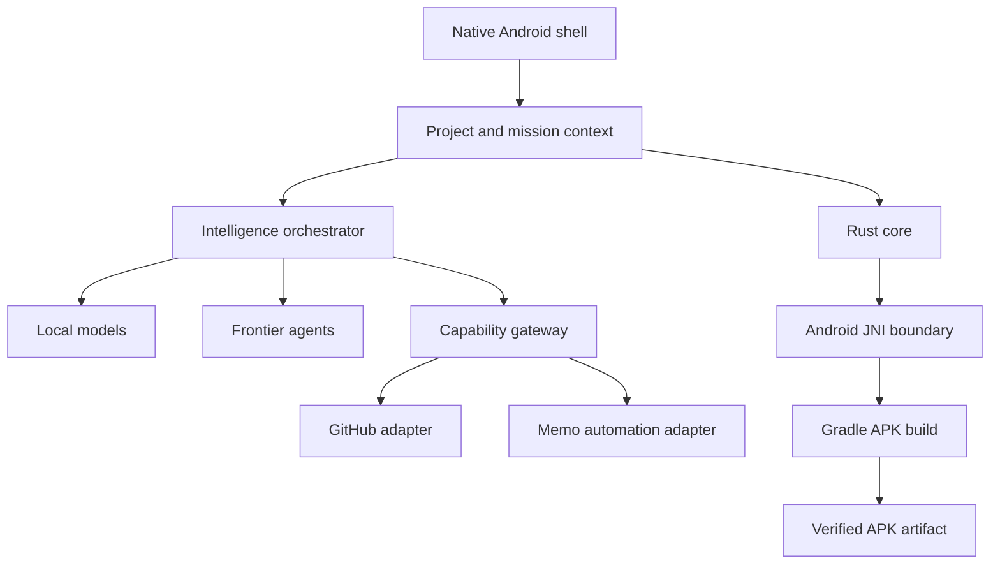

# PocketForge

PocketForge is a local-first, mobile-native development Nexus and production factory. It connects local intelligence, frontier agents, GitHub and automation providers to real projects, then turns approved changes into tested Android software. Android is the primary production target. iOS is contract-scaffolded and gated.

## Phase map

| Phase | Outcome | Acceptance evidence |
|---|---|---|
| 0 — Keystone | Product/architecture foundation, Rust ABI scaffold, Android placeholder APK, direct GitHub CI | Three Rust Android ABIs compile; debug APK builds, verifies and is downloadable from Actions |
| 1 — Local factory | Project workspace, import, local toolchain and repeatable builds | Two real Android projects build and install on the target device |
| 2 — Intelligence Nexus | Local/frontier providers, capability routing and durable missions | A delegated task produces traceable, reviewed changes |
| 3 — Connectors | Direct GitHub integration and Memo automation adapter | Remote changes are reviewed and imported without manual file shuffling |
| 4 — Production loop | Diagnostics, tests, signing and release artifacts | Agent-to-verified-APK workflow works end to end |
| 5 — Expansion | Additional providers, project types and platform support | Expansion is evidence-backed; iOS separately approved |

## Quickstart

From the repository root:

```bash
./scripts/verify-foundation.sh
./scripts/build-rust.sh
./scripts/build-android.sh debug
```

See [local development](docs/operations/local-development.md) for prerequisites and [release process](docs/operations/release-process.md) for protected signing.

## Architecture



## Repository navigation

- Product definition: `docs/product/`
- Architecture and FFI contract: `docs/architecture/`
- Architectural decisions: `docs/decisions/`
- Threat model and security policy: `docs/security/`
- Build, phase and release operations: `docs/operations/`
- Agent roles and skills: `.agent/`
- Rust core: `core/`
- Android shell: `android/`
- iOS contract scaffold: `ios/`
- GitHub Actions: `.github/workflows/`

## Delivery model

**GitHub is the source of truth.** Work lands as normal commits and reviewed pull requests in this repository. The permanent `.github/workflows/pipeline.yml` checks out the exact commit, validates the foundation, cross-compiles Rust for Android ABIs, assembles and verifies the debug APK, generates an SBOM and attests build provenance. The APK is published as a GitHub Actions artifact.

There is no ZIP ingestion, phase-upload repository, HTML, browser UI or web application. No workflow creates another repository. Release signing remains a separate, manually dispatched workflow behind the protected `android-release` GitHub Environment.

PocketForge remains independent from Memo. Memo is an external browser/app automation provider; GitHub and frontier agents remain separate integrations.

## Foundation status

This repository currently contains contracts, documentation and placeholder scaffolds. A successful CI run and a physical-device install are required before Phase 0 can be called accepted. Check [the acceptance ledger](docs/operations/acceptance-ledger.md) for evidence rather than assumptions.
