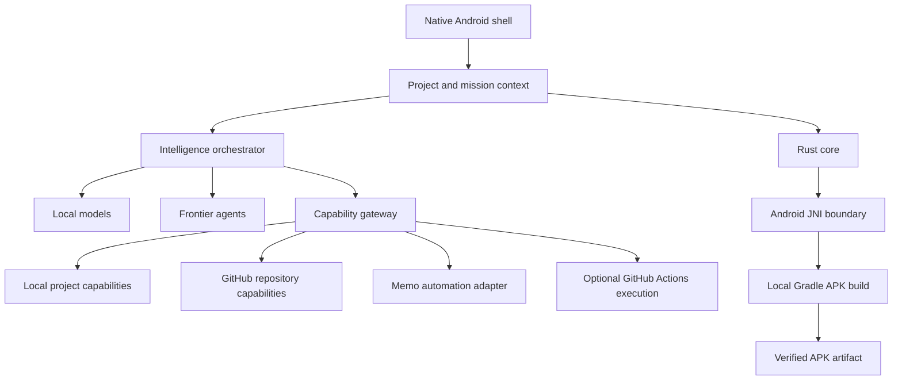

# PocketForge

PocketForge is a local-first, mobile-native development Nexus and production factory. It connects local intelligence, frontier agents, GitHub and automation providers to real projects, then turns approved changes into tested Android software. Android is the primary production target. iOS is contract-scaffolded and gated.

## Two first-class project modes

PocketForge must support both ways of working, through the same mission engine:

- **Local mode:** work directly with project folders on the Android device, local intelligence and local build/test/sign/install capabilities. This path must remain useful without a GitHub account, hosted runner or cloud build service.
- **GitHub mode:** connect to a repository and work directly against it: inspect files and history, create branches, propose and apply scoped changes, review diffs, commit, open pull requests, inspect checks and retrieve artifacts. Remote writes require the relevant grant and approval.

These are project-source modes, not separate products or separate AI workflows. A mission can target a local workspace or a GitHub repository. GitHub Actions is an optional remote execution/build capability, not a prerequisite for local compilation or signing.

## Phase map

| Phase | Outcome | Acceptance evidence |
|---|---|---|
| 0 — Keystone | Product/architecture/security foundation, Rust ABI scaffold and Git-native CI | Three Rust Android ABIs compile; debug APK builds, verifies and is downloadable from Actions |
| 1 — Local factory + GitHub workspace | Project workspace, folder import, Project Passports, repository connection and local build toolchain | Local and GitHub projects can be selected as mission targets; repository reads/branch/diff/PR flow is verified; two real Android projects build and install locally |
| 2 — Intelligence Nexus | Local/frontier providers, one mission engine, capability routing and agent execution | The same bounded mission lifecycle produces traceable, reviewed changes against either project mode |
| 3 — Automation connectors | Memo automation adapter and additional verified providers | Memo remains a separate adapter; provider/tool permissions and observed outcomes are verified |
| 4 — Production loop | Diagnostics, tests, signing and artifact vault | A reviewed agent change becomes a tested signed APK with verifiable provenance through the local path; optional remote builds are separately verified |
| 5 — Expansion | Additional providers, project types and platform support | Expansion is evidence-backed; iOS separately approved |

## Current implementation

The first native product slice is implemented in the Android shell:

- A local workspace with project cards and Project Passport creation.
- Existing project folders can be linked through Android's system document-tree picker; PocketForge verifies the persisted permission, scans the root, identifies common project markers and provides a scoped file browser. Files stay in their original folder; they are not copied or uploaded.
- Missions can be created, linked to a local folder or GitHub repository, and kept in a local queue with Draft / Ready states.
- GitHub repositories can be connected using a pasted GitHub URL or `owner/repository`, verified against the GitHub API, and pinned to an immutable default-branch commit. Public repositories need no token; private repositories can use an encrypted fine-grained token. The initial reviewed single-file branch/commit/PR flow checks the pinned base and current blob SHA.
- Optional fine-grained GitHub tokens are encrypted with Android Keystore AES-GCM; only the encrypted payload is stored in app-private preferences.
- The Factory screen distinguishes PocketForge's own verified CI APK build from capabilities that are still missing for imported projects.

This is implementation status, not device acceptance. The Android source for local-folder inspection and GitHub connection/browsing has passed the current CI APK build. The user has launched an earlier build, but the improved folder and GitHub flows still need hands-on acceptance on the target phone. The Rust bridge remains a minimal ABI scaffold; local compilation of imported projects, agent execution and the Memo adapter are not implemented yet.

## First-use flows

**Link a local project:** On the Workspace screen, tap **Import local project folder**, choose the project root in Android's folder picker and grant access. PocketForge then asks for a project name and offers **Link & inspect**. The next screen reports the folder, top-level entries and any recognized project type. Use **Browse files** to inspect subfolders and open files with Android's installed apps. The source remains in its original location; it is not copied or uploaded, and it is not built yet.

**Connect GitHub:** Tap **Connect GitHub repository** and paste either `https://github.com/owner/repository` or `owner/repository`. Public repositories do not need a token. For a private repository, provide a fine-grained token with Metadata read-only and Contents read-only permissions. Tap **Verify and connect**. A successful connection opens the project overview and displays its pinned commit; use **Browse files** to inspect the pinned source. A connection cannot proceed if PocketForge cannot pin an immutable commit.

**Keeping the previous install safe:** the new development build is a separate **PocketForge Preview** app (`com.pocketforge.app.preview`), while the earlier test app remains `com.pocketforge.app.debug`. They can coexist; the old app and its saved records are not removed. App-private records and folder permissions are not shared between packages, so link the project folder again in Preview.

## Quickstart

From the repository root:

```bash
bash scripts/verify-foundation.sh
bash scripts/build-rust.sh
(cd android && gradle --no-daemon assembleDebug)
```

The second command builds the Rust JNI libraries for all configured Android ABIs; the third assembles the Android debug APK. The equivalent one-command helper is `bash scripts/build-android.sh debug`. See [local development](docs/operations/local-development.md) for prerequisites and [release process](docs/operations/release-process.md) for protected signing.

## Architecture

Binding mission-execution constraints: [mission execution invariants](docs/architecture/mission-execution-invariants.md). All development missions use one provider-agnostic, scoped execution lifecycle; examples are not hardcoded workflows.



## Repository navigation

- Product definition: `docs/product/`
- Architecture and FFI contract: `docs/architecture/`
- Architectural decisions: `docs/decisions/`
- Threat model and security policy: `docs/security/`
- Build, phase and release operations: `docs/operations/`
- Agent roles and skills: `.agent/`
- Rust core: `core/`
- Android shell: `android/`
- iOS contract scaffold: `ios/`
- GitHub Actions: `.github/workflows/`

## Delivery model

**GitHub is the source of truth for PocketForge's own code.** Work lands as normal commits and reviewed pull requests in this repository. The permanent `.github/workflows/pipeline.yml` is intended to check out the exact commit, validate the foundation, cross-compile Rust for Android ABIs, assemble and verify the debug APK, generate an SBOM and attest build provenance. The APK is published as a GitHub Actions artifact when a runner executes successfully.

PocketForge's in-app GitHub mode is also a first-class project path for users' repositories; it is distinct from the CI pipeline that builds PocketForge itself. GitHub Actions may provide optional remote build/test execution, but it must not become a dependency for local project compilation, signing or installation.

There is no ZIP ingestion, phase-upload repository, HTML, browser UI or web application. No workflow creates another repository. Release signing remains a separate, manually dispatched workflow behind the protected `android-release` GitHub Environment.

PocketForge remains independent from Memo. Memo is an external browser/app automation provider; GitHub and frontier agents remain separate integrations.

## Acceptance status

The source-level onboarding revision has a successful Android CI build in [run #109](https://github.com/ysfclc/PocketForge/actions/runs/44793160312), and the static security job passed `actionlint`, the foundation verifier, `cargo deny check` and `cargo audit`. The earlier CI artifact was signed with a runner-local debug key that differs from the first installed build, so it is not a safe in-place update. The new side-by-side Preview package uses a private persistent signing key; its trusted build is intentionally gated until the four repository Actions secrets in [the Preview signing guide](docs/operations/preview-signing.md) are configured. The separate Dependency Review action remains blocked because GitHub Dependency Graph is disabled. Physical-device acceptance of local-folder and GitHub flows remains pending. Local compilation/building of imported projects, mission execution and agent integration remain unimplemented. See [the acceptance ledger](docs/operations/acceptance-ledger.md) for exact evidence.


## Preview signing setup

To preserve the old install and allow repeatable in-place updates of PocketForge Preview, configure the private signing secrets once. Follow [the Preview signing guide](docs/operations/preview-signing.md). The keystore and passwords are never committed to this public repository.
