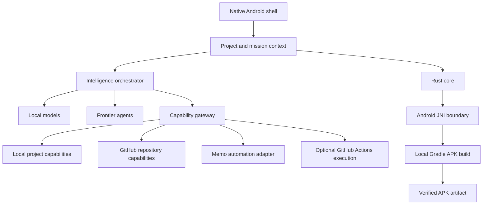

# PocketForge

PocketForge is a local-first, mobile-native development Nexus and production factory. It connects local intelligence, frontier agents, GitHub and automation providers to real projects, then turns approved changes into tested Android software. Android is the primary production target. iOS is contract-scaffolded and gated.

## Two first-class project modes

PocketForge must support both ways of working, through the same mission engine:

- **Local mode:** work directly with project folders on the Android device, local intelligence and local build/test/sign/install capabilities. This path must remain useful without a GitHub account, hosted runner or cloud build service.
- **GitHub mode:** connect to a repository and work directly against it: inspect files and history, create branches, propose and apply scoped changes, review diffs, commit, open pull requests, inspect checks and retrieve artifacts. Remote writes require the relevant grant and approval.

These are project-source modes, not separate products or separate AI workflows. A mission can target a local workspace or a GitHub repository. GitHub Actions is an optional remote execution/build capability, not a prerequisite for local compilation or signing.

## Phase map

| Phase | Outcome | Acceptance evidence |
|---|---|---|
| 0 — Keystone | Product/architecture/security foundation, Rust ABI scaffold and Git-native CI | Three Rust Android ABIs compile; debug APK builds, verifies and is downloadable from Actions |
| 1 — Local factory + GitHub workspace | Project workspace, folder import, Project Passports, repository connection and local build toolchain | Local and GitHub projects can be selected as mission targets; repository reads/branch/diff/PR flow is verified; two real Android projects build and install locally |
| 2 — Intelligence Nexus | Local/frontier providers, one mission engine, capability routing and agent execution | The same bounded mission lifecycle produces traceable, reviewed changes against either project mode |
| 3 — Automation connectors | Memo automation adapter and additional verified providers | Memo remains a separate adapter; provider/tool permissions and observed outcomes are verified |
| 4 — Production loop | Diagnostics, tests, signing and artifact vault | A reviewed agent change becomes a tested signed APK with verifiable provenance through the local path; optional remote builds are separately verified |
| 5 — Expansion | Additional providers, project types and platform support | Expansion is evidence-backed; iOS separately approved |

## Current implementation

The first native product slice is in place in the Android shell:

- A local workspace with project cards and Project Passport creation.
- Existing project folders can be linked through Android's system document-tree picker; the persisted folder permission stays on-device.
- Missions can be created, linked to a project, and kept in a local queue with Draft / Ready states.
- GitHub repositories can be connected by `owner/repository`, verified against the GitHub API, saved as project sources and browsed at a pinned commit (repository metadata, directories and text files), with an initial reviewed single-file branch/commit/PR flow.
- Optional fine-grained GitHub tokens are encrypted with Android Keystore AES-GCM; only the encrypted payload is stored in app-private preferences.
- The Factory screen reports the real build-gate status instead of pretending that a build or agent run happened.

This is implementation status, not device acceptance. The Rust bridge remains a minimal ABI scaffold; agent execution, the Memo adapter and local project compilation are not implemented yet. The GitHub adapter now includes a reviewed single-file branch/commit/PR path in source; build and device verification remain pending. The new GitHub connector has not yet passed an Android build or device test.

## Quickstart

From the repository root:

```bash
./scripts/verify-foundation.sh
./scripts/build-rust.sh
(cd android && gradle --no-daemon assembleDebug)
```

The second command builds the Rust JNI libraries for all configured Android ABIs; the third assembles the Android debug APK. The equivalent one-command helper is `./scripts/build-android.sh debug`. See [local development](docs/operations/local-development.md) for prerequisites and [release process](docs/operations/release-process.md) for protected signing.

## Architecture

Binding mission-execution constraints: [mission execution invariants](docs/architecture/mission-execution-invariants.md). All development missions use one provider-agnostic, scoped execution lifecycle; examples are not hardcoded workflows.



## Repository navigation

- Product definition: `docs/product/`
- Architecture and FFI contract: `docs/architecture/`
- Architectural decisions: `docs/decisions/`
- Threat model and security policy: `docs/security/`
- Build, phase and release operations: `docs/operations/`
- Agent roles and skills: `.agent/`
- Rust core: `core/`
- Android shell: `android/`
- iOS contract scaffold: `ios/`
- GitHub Actions: `.github/workflows/`

## Delivery model

**GitHub is the source of truth for PocketForge's own code.** Work lands as normal commits and reviewed pull requests in this repository. The permanent `.github/workflows/pipeline.yml` is intended to check out the exact commit, validate the foundation, cross-compile Rust for Android ABIs, assemble and verify the debug APK, generate an SBOM and attest build provenance. The APK is published as a GitHub Actions artifact when a runner executes successfully.

PocketForge's in-app GitHub mode is also a first-class project path for users' repositories; it is distinct from the CI pipeline that builds PocketForge itself. GitHub Actions may provide optional remote build/test execution, but it must not become a dependency for local project compilation, signing or installation.

There is no ZIP ingestion, phase-upload repository, HTML, browser UI or web application. No workflow creates another repository. Release signing remains a separate, manually dispatched workflow behind the protected `android-release` GitHub Environment.

PocketForge remains independent from Memo. Memo is an external browser/app automation provider; GitHub and frontier agents remain separate integrations.

## Acceptance status

The workspace and mission slice is authored but awaits a successful APK build and physical install. The latest GitHub Actions jobs still terminate before runner allocation, so no APK artifact exists yet. The first read-only GitHub repository connector is authored but awaits Android build/device verification. A reviewed single-file branch/commit/PR flow is now authored, including pinned-base branch creation, blob-SHA stale-write checks, a line-based diff preview and separate PR approval. Build and device verification remain pending. Check [the acceptance ledger](docs/operations/acceptance-ledger.md) for evidence rather than assumptions.
